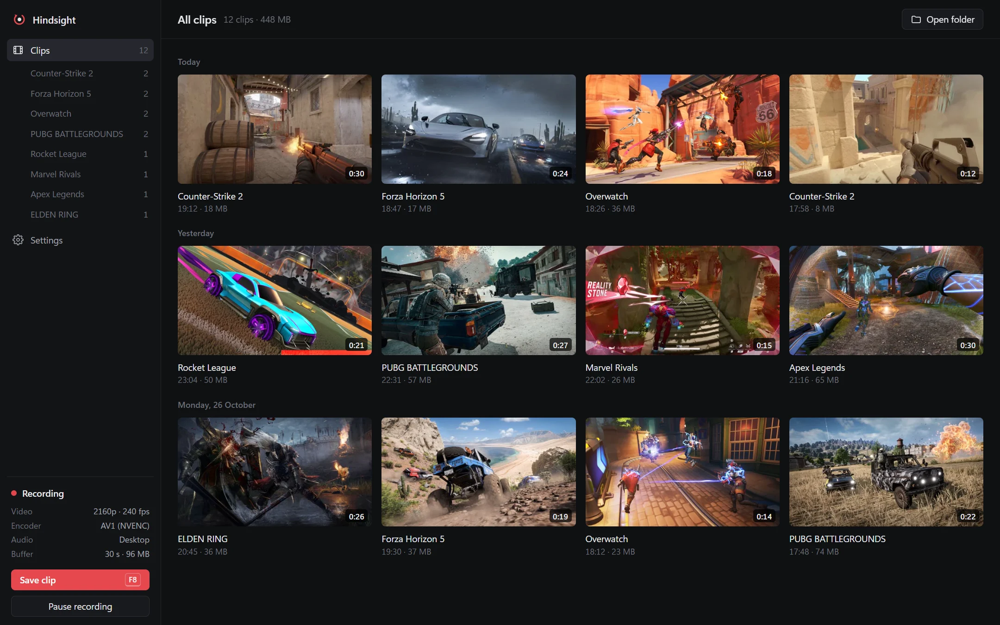
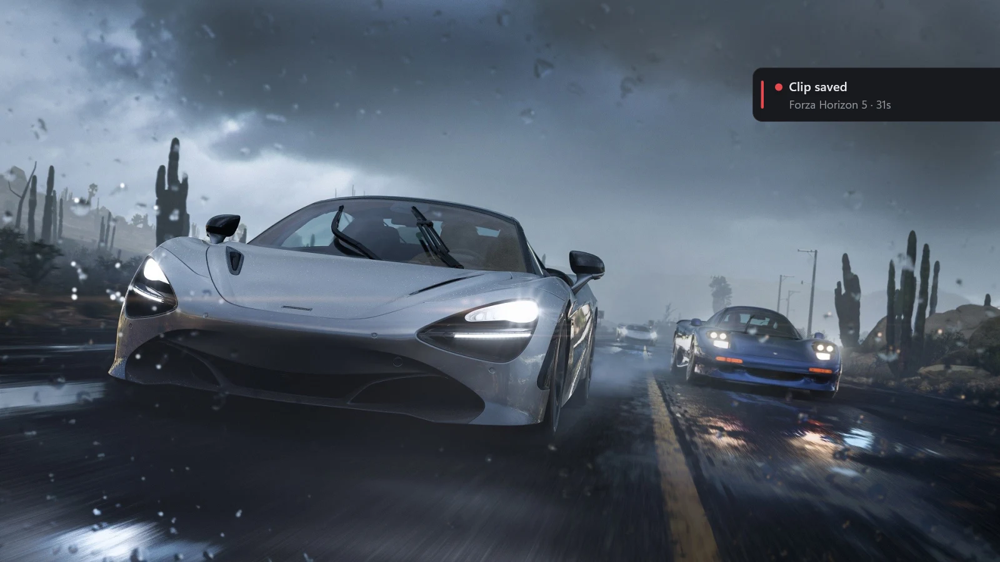
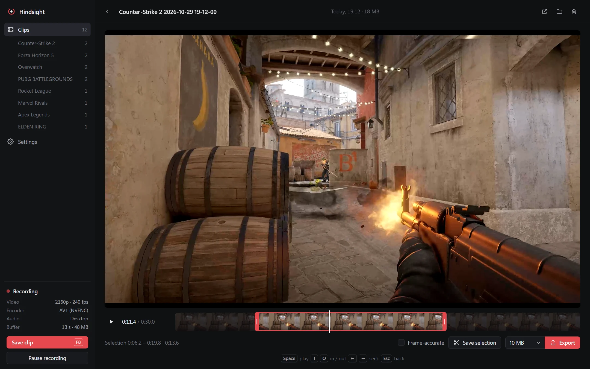
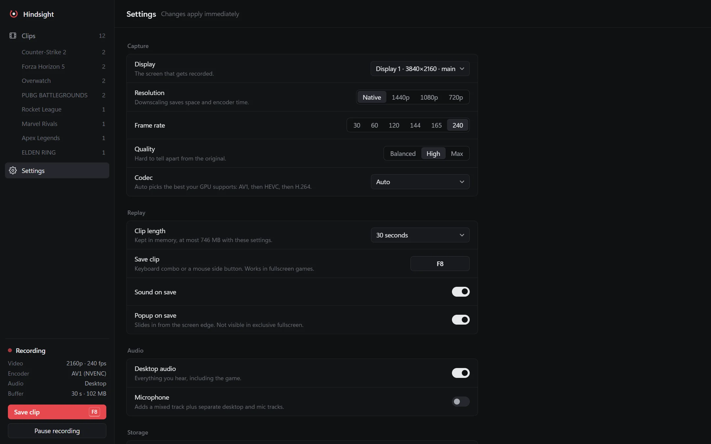

<div align="center">


# Hindsight

**Instant replay for Windows. Press a key, keep the last minute.**

Hindsight records your screen into a replay buffer on the GPU, all the time, and saves it as an MP4 the moment you press the hotkey.<br>
No account, no uploads, no overlay injected into your games.

<br>

[](#status)
[](#requirements)
[](#how-it-works)
[](#how-it-works)
[](#your-data)
[](#license)

<br>

**[Website](https://hindsighthq.app)** &nbsp;·&nbsp; **[Features](#features)** &nbsp;·&nbsp; **[Install](#install)** &nbsp;·&nbsp; **[How it works](#how-it-works)** &nbsp;·&nbsp; **[Performance](#performance)** &nbsp;·&nbsp; **[Building](#building-from-source)** &nbsp;·&nbsp; **[FAQ](#faq)**

<br>



<sub>The library, grouped by day. The sidebar shows what the recorder is doing right now.<br>Screenshots show the real app. The demo clips are made from screenshots on the games' Steam store pages; the games and their trademarks belong to their owners.</sub>

</div>

<br>

## What is Hindsight?

Clipping tools tend to grow accounts, feeds, cloud uploads and an Electron window that sits next to your game. Hindsight does one thing: it keeps the last few seconds or minutes of your screen and saves them when you ask.

- **Always on, nearly free.** Frames go from the screen to the GPU's video encoder without ever being copied to the CPU. The recorder process doesn't load a browser engine.
- **Instant saves.** A clip is cut from what is already encoded, so saving a minute of 4K takes about a third of a second, with no re-encode.
- **Your files.** Clips are plain MP4s in `Videos\Hindsight`. Nothing leaves your PC.

<br>

## Features

### Replay buffer and hotkey

<table>
<tr>
<td width="60%" valign="top">



</td>
<td width="40%" valign="top">

- **Hotkey anywhere**: a key, a combo or a mouse side button. It works in fullscreen games and never takes the key away from the game.
- **Confirmation without injection**: a short chime and a small card that slides out of the screen edge. The card is hidden from capture, so it never ends up in a later clip.
- **Up to 240 fps** at native resolution, or downscaled to 1440p, 1080p or 720p.
- **Clip length** from 15 seconds to 5 minutes, kept in memory.
- **Audio sources**: everything on an output device, or only the apps you pick (the game without Discord or music), plus a microphone. Choose the devices, and keep each source on its own track next to the mix.
- **Tray popout**: click the tray icon for status, save, pause and the settings you change most.

</td>
</tr>
</table>

### Player and editing

<table>
<tr>
<td width="40%" valign="top">

- **Instant scrubbing**: each clip carries a small all-keyframe preview, so dragging the timeline shows every frame as you move.
- **Trim** with handles or `I` / `O`. A trimmed copy saves instantly by cutting on keyframes, or frame-accurately with a GPU re-encode.
- **Export presets** for where it's going: Discord (20 MB), Nitro Basic (50 MB), Nitro (1 GB), WhatsApp, email, X, or any size. The export picks the resolution and frame rate the size can carry, and AV1 is one click away when the other side can play it.
- **Library**: grouped by day, filtered by game, hover a thumbnail to skim it.

</td>
<td width="60%" valign="top">



</td>
</tr>
</table>

### Settings

<table>
<tr>
<td width="60%" valign="top">



</td>
<td width="40%" valign="top">

- **Encoder picked for you**: AV1, then HEVC, then H.264, on NVIDIA (NVENC), AMD (AMF) or Intel (Media Foundation). If one fails, the next takes over.
- **Quality presets** that map to constant-quality encoding with a bitrate cap, so fast motion can't blow up the buffer.
- **Changes apply immediately**; recording restarts in about a tenth of a second.
- **Start with Windows** quietly in the tray.

</td>
</tr>
</table>

### Your data

No account, no telemetry, no update checks, no network access at all. Settings, logs and caches live in `%LOCALAPPDATA%\app.hindsight.clips`; clips go to the folder you choose.

<br>

## What Hindsight won't do

- **Inject into games.** No hooks, no DLLs, no in-game overlay. That keeps it safe with anti-cheat (Vanguard, Easy Anti-Cheat, BattlEye) and is why the popup can't appear over exclusive-fullscreen games (the chime still plays).
- **Upload anything.** Sharing is up to you: export to a size and drag the file where you want it.
- **Run a browser next to your game.** The library window is a separate process that exits completely when you close it.

<br>

## Install

> [!NOTE]
> Download `Hindsight_1.0.0_x64-setup.exe` from [Releases](https://github.com/TheOriUHD/hindsight/releases/latest). It installs per user, no admin needed. **The installer is not code-signed**, so SmartScreen shows "unknown publisher" (More info › Run anyway).

Hindsight starts in the tray and opens its window. Press **F8** in a game to save a clip. Closing the window leaves recording running; **Quit Hindsight** in the tray menu stops it.

### Requirements

- Windows 10 2004 or later, or Windows 11. Windows 11 24H2 records above 60 fps with Windows Graphics Capture; older versions use Desktop Duplication automatically.
- A GPU with a hardware video encoder: NVIDIA GTX 10-series or newer, AMD RX 400 or newer, or Intel graphics with Quick Sync. AV1 needs RTX 40, RX 7000 or Arc.
- WebView2 for the library window (part of Windows 11; the installer fetches it on Windows 10 if missing).

<br>

## How it works

```
Screen ─▶ Windows Graphics Capture (D3D11 texture)
       ─▶ GPU video processor: BGRA → NV12, scale          ← never leaves the GPU
       ─▶ NVENC / AMF / Media Foundation encoder
       ─▶ compressed packets in a RAM ring buffer           ← a few hundred MB at most
hotkey ─▶ cut at the nearest keyframe, remux to MP4         ← no re-encode
```

- **Constant frame rate.** Capture only delivers frames when the screen changes; an encoder thread fills gaps by repeating the last frame, so clips are true 60/120/240 fps files that editors and Discord handle.
- **One clock.** Video timestamps, WASAPI audio positions and the hotkey press all use the same QPC clock, and audio is padded with silence across gaps, so sound stays in sync for the whole buffer.
- **Two processes, one exe.** `hindsight.exe` is the recorder and tray icon. `hindsight.exe --ui` is the library window, started on demand, talking to the recorder over a local named pipe.

| Crate | Does |
|---|---|
| [`crates/capture`](crates/capture) | Windows Graphics Capture and DXGI Desktop Duplication, adapter selection |
| [`crates/encode`](crates/encode) | GPU colour conversion, hardware video encode, AAC, MP4 muxing (FFmpeg) |
| [`crates/recorder`](crates/recorder) | Pipeline, audio capture and mixing, replay buffer, hotkeys, popup |
| [`app`](app) | Tauri tray app, IPC, library, trim and export |
| [`ui`](ui) | The library window: plain HTML, CSS and JavaScript |

<br>

## Performance

Measured on a Ryzen 9 9950X3D2 with an RTX 5090, recording a 3840×2160 display:

| | |
|---|---|
| Recorder CPU at 4K60 | about 4.5% of one core |
| 4K at 240 fps | 0 dropped frames (encoder preset scales with pixel rate) |
| Saving a 4K clip | about 0.3 s |
| Trimmed copy, keyframe cut | about 0.1 s |
| Scrubbing a frame | about 2 ms |
| Memory | the replay buffer (Settings shows the maximum) plus about 0.5 GB the NVIDIA driver reserves for a 4K encoder session |

Game frame-rate impact has not been benchmarked across titles yet. If you measure it with PresentMon or CapFrameX, an issue with the numbers is very welcome.

<br>

## Building from source

Needs Rust (stable, MSVC toolchain), Node.js, and the Visual Studio Build Tools.

```powershell
powershell -ExecutionPolicy Bypass -File scripts\setup.ps1   # FFmpeg 8.1 LGPL build + libclang into vendor\
npm install
npx tauri build                                              # target\release\bundle\nsis\Hindsight_*-setup.exe
```

`cargo build --release -p hindsight` builds just the exe; the FFmpeg DLLs are copied next to it.

<br>

## Status

Version 1.0. It is in daily use on NVIDIA hardware; AMD and Intel paths are implemented but have seen far less testing. Known gaps:

- Desktop Duplication (used before Windows 11 24H2) doesn't draw the mouse cursor.
- HDR displays are recorded as SDR without tone mapping.
- Intel GPUs use Media Foundation rather than Quick Sync directly.
- The replay buffer lives in RAM only; there is no disk-backed buffer for very long clips.

<br>

## FAQ

**Will this get me banned?**
Hindsight captures the screen through the same Windows APIs as OBS's Display Capture and the Snipping Tool. It doesn't touch game processes, so anti-cheat has nothing to see.

**Why doesn't the popup show in my game?**
The game is in exclusive fullscreen, which draws over every window. Switch the game to borderless (most modern games default to it) or rely on the chime.

**Where do clips go?**
`Videos\Hindsight`, named after the window that was in front, like `Valorant 2026-10-29 21-14-08.mp4`. Change the folder in Settings.

**How much memory does it use?**
Settings shows the most the replay buffer can take with your settings. At 4K 60 fps on High it's around 400 MB for a minute; typical gameplay uses less.

**Does it phone home?**
No. Hindsight makes no network requests.

<br>

## License

Hindsight is source-available under the [PolyForm Noncommercial License 1.0.0](LICENSE): use, study, change and share it for any noncommercial purpose. FFmpeg is included as unmodified LGPL 2.1 shared libraries; see [THIRD_PARTY_NOTICES.md](THIRD_PARTY_NOTICES.md).

## Credits

Built on [Tauri](https://tauri.app), [windows-rs](https://github.com/microsoft/windows-rs), [FFmpeg](https://ffmpeg.org) (via [ffmpeg-sys-next](https://github.com/zmwangx/rust-ffmpeg-sys) and the [BtbN builds](https://github.com/BtbN/FFmpeg-Builds)) and Direct2D.

<div align="center">

<br>

<sub>Hindsight · instant replay for Windows · press a key, keep the last minute</sub>

</div>
